<p align="center">
  
</p>

<p align="center">
  <a href="https://sharing-123.github.io/tumor-associated-brain-frailty-and-perioperative-brain-injury-scoping-review/"><b>Interactive site</b></a>
  &nbsp;/&nbsp;
  <a href="manuscript/Scoping_Review_PBI_preview.pdf"><b>Manuscript PDF</b></a>
  &nbsp;/&nbsp;
  <a href="supplementary/Supplementary_Tables_S1-S6.xlsx"><b>Supplementary tables</b></a>
  &nbsp;/&nbsp;
  <a href="CITATION.cff"><b>Cite</b></a>
</p>

## Overview

Open materials for the scoping review **Tumor-Associated Brain Frailty and Perioperative Brain Injury in Neuro-Oncologic Surgery: A Scoping Review**, by Khairunnisai Tarimah and Elvan Wiyarta.

The review maps 76 studies (70 core studies and 6 on the Indonesian MoCA and NANO instruments) against four candidate domains of tumor-associated brain frailty, neuroinflammatory mechanisms, brain injury biomarkers, and a two-hit model of perioperative brain injury. It follows JBI guidance and PRISMA-ScR. The review was not registered. This repository is its public record.

| Archive | Link |
| --- | --- |
| Zenodo | to be added after release |

## Findings at a glance

| | |
| --- | --- |
| Records identified and screened | 2,476 identified, 1,331 screened after 987 duplicates |
| Studies included | 76 (70 core, 6 instrument-focused) |
| Cognition before surgery | impaired in 8 of 8 studies that tested it |
| New diffusion-weighted lesions after resection | 18.8% to 45.7% |
| Core studies using MoCA-INA or NANO-Ina | 0 |

## Repository map

| Folder | Contents |
| --- | --- |
| `docs/` | Source of the interactive site: WebGL hero, evidence map, two-hit model, and a particle-brain analysis lab |
| `manuscript/` | Full manuscript in Word with live Zotero citation fields (NLM superscript) and a PDF preview |
| `supplementary/` | Supplementary Tables S1 to S6 in one Excel workbook |
| `figures/` | The five manuscript figures, 300 dpi PNG |
| `data/` | Search strategies, 31-item charting form for 76 studies, study coding, reference verification log, verified reference records |
| `code/` | Python scripts that generate every count, table, figure, and the manuscript |

## Rebuilding the outputs

Scripts in `code/` use relative paths. Place the extraction workbook and the search-result document in `inputs/`, run from inside `code/`, and write results to `outputs/`.

```bash
cd code
python -X utf8 prisma_numbers.py
python -X utf8 build_docx.py
```

The Zotero step in `zupload.py` reads its key from the `ZOTERO_API_KEY` environment variable. The extraction workbook, the Zotero library, and the full-text PDFs of included studies are not part of this repository.

## Running the site locally

```bash
python -m http.server 8000 --directory docs
```

Open `http://localhost:8000`. Drag the particle brain to rotate it, move the two sliders to change the hits, and click an evidence row to filter the 3D map.

## Credits

The site uses [three.js](https://threejs.org) and [threejs-components](https://github.com/kevin-levron/threejs-components) (MIT).

## Licence and citation

The licence is to be set by the authors before the Zenodo release. See `CITATION.cff` for citation metadata.
